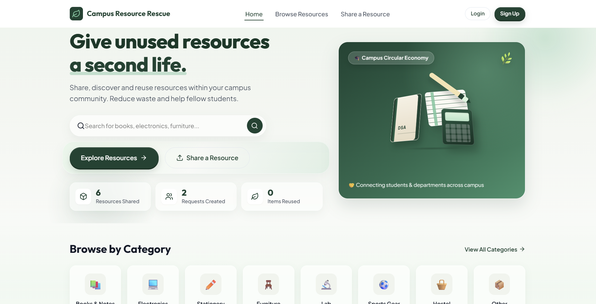
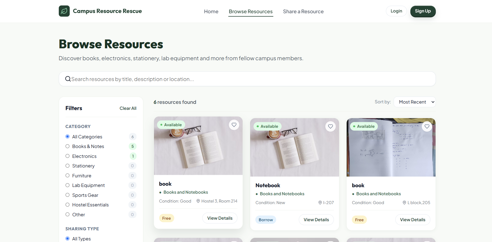
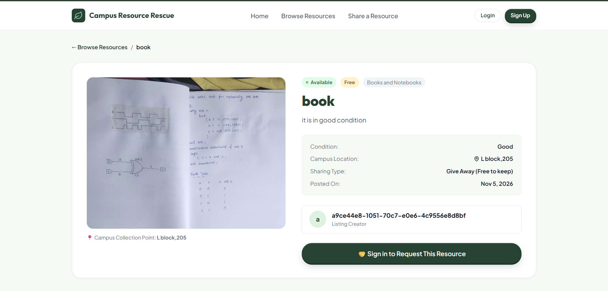
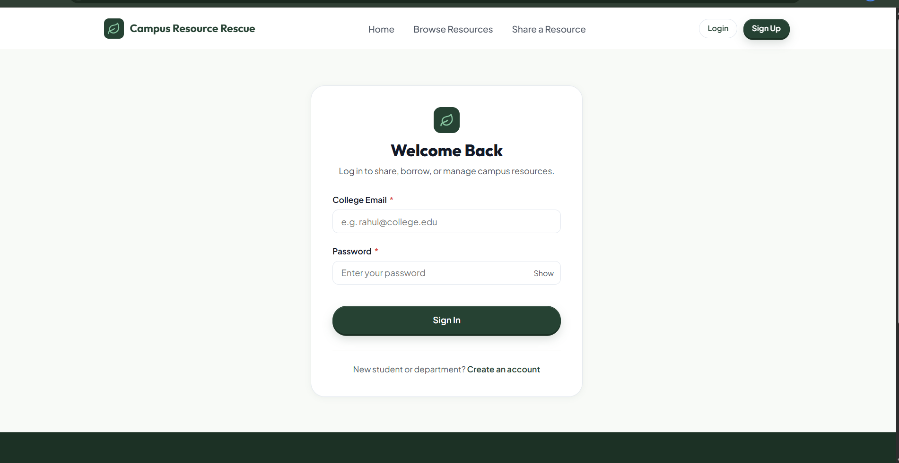
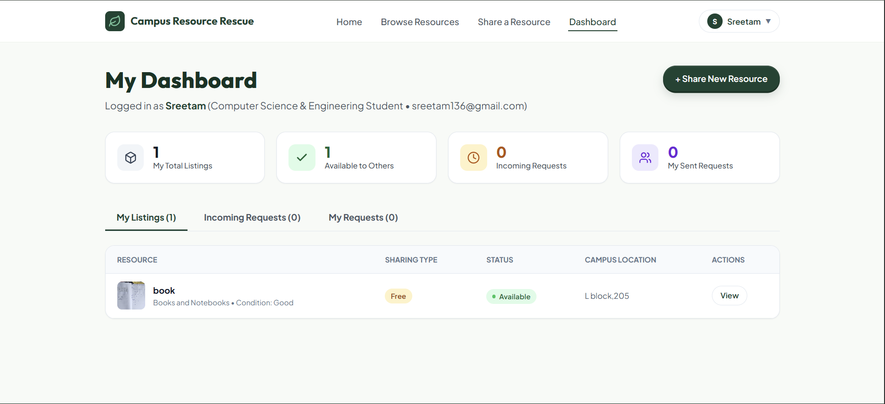
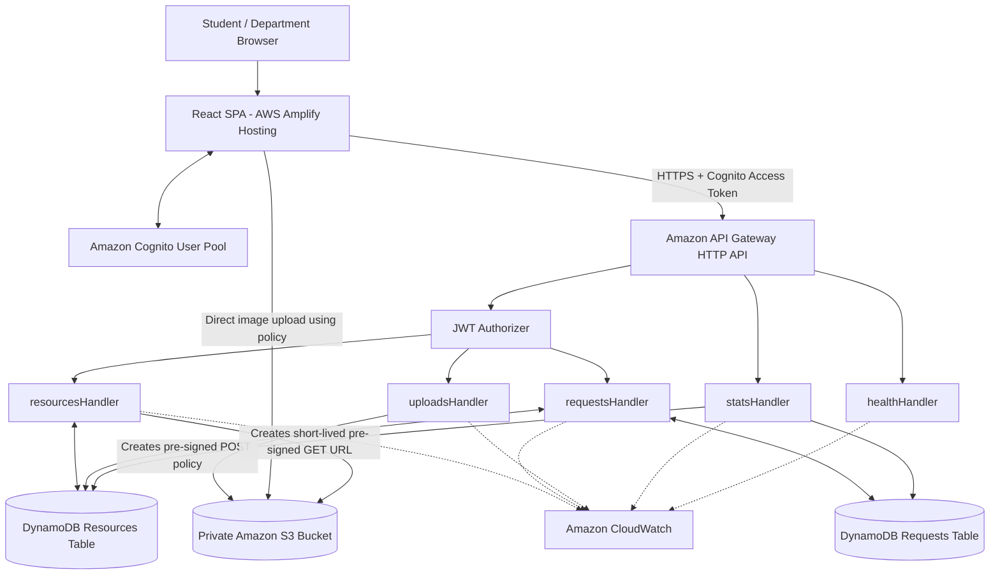
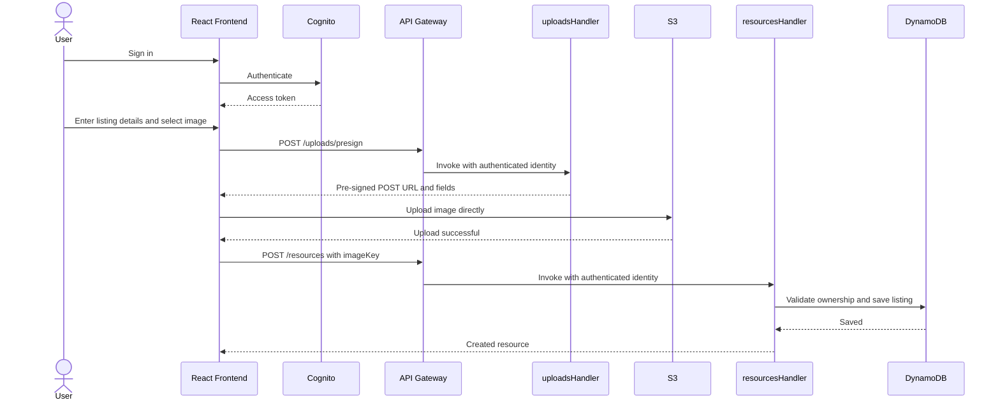
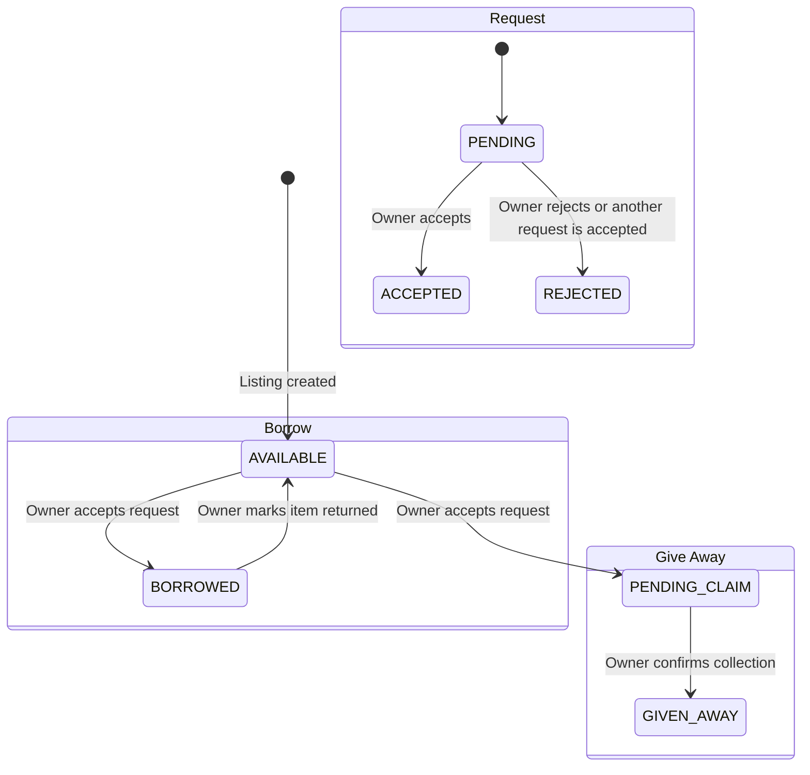

# Campus Resource Rescue

A campus-based resource-sharing platform that helps students and departments donate, lend, borrow, and request unused resources instead of letting them go to waste.

## Live Demo

**Live Website:** [Campus Resource Rescue](https://main.d3dibxtbw38fiq.amplifyapp.com/)

The frontend is deployed using **AWS Amplify Hosting**. The backend runs on AWS serverless services in the `ap-southeast-2` (Sydney) region.

## Screenshots

### Homepage



### Browse Resources



### Resource Details



### Login and Registration



### Dashboard



The frontend is deployed using **AWS Amplify Hosting**. The backend runs
on AWS serverless services in the `ap-southeast-2` (Sydney) region.

------------------------------------------------------------------------

## Table of Contents

-   [Overview](#overview)
-   [Problem Statement](#problem-statement)
-   [Features](#features)
-   [Technology Stack](#technology-stack)
-   [System Architecture](#system-architecture)
-   [Application Workflows](#application-workflows)
-   [Database Design](#database-design)
-   [API Overview](#api-overview)
-   [Project Structure](#project-structure)
-   [Local Development](#local-development)
-   [Environment Variables](#environment-variables)
-   [Deployment](#deployment)
-   [Security](#security)
-   [Testing](#testing)
-   [Limitations and Future
    Improvements](#limitations-and-future-improvements)

------------------------------------------------------------------------

## Overview

Campus Resource Rescue provides a centralised platform for exchanging
useful resources within a campus community. Students and departments can
list items they no longer need, browse available resources, and request
items for permanent transfer or temporary borrowing.

The platform supports two sharing models:

-   **Give Away:** an item is permanently transferred to another campus
    member.
-   **Borrow:** an item is lent temporarily and can become available
    again after it is returned.

The application uses a React frontend and an AWS serverless backend.
Authentication is handled by Amazon Cognito, application APIs are
exposed through API Gateway, business logic runs in AWS Lambda, resource
data is stored in DynamoDB, and images are stored privately in Amazon
S3.

## Problem Statement

At the end of each semester, useful textbooks, stationery, electronics,
laboratory equipment, sports items, and hostel essentials may remain
unused or be discarded. At the same time, other students spend money
acquiring similar items.

Campus Resource Rescue aims to reduce this waste and make useful
resources easier to find by enabling controlled sharing within a campus
community.

## Features

### User accounts

-   Registration using an email address and password.
-   Email verification through Amazon Cognito.
-   Login and authenticated sessions.
-   Student and department account types.

### Resource listings

-   Create listings with a title, description, category, condition,
    sharing type, pickup location, and optional image.
-   Support for `GIVE_AWAY` and `BORROW` listings.
-   Owner-controlled resource status updates.

### Browse and discover

-   Browse available resources.
-   Filter by category, condition, and sharing type.
-   View resource details and listing information.
-   Paginated resource results.

### Request management

-   Submit a request with a message to the resource owner.
-   View sent requests and incoming requests.
-   Accept or reject requests as the owner.
-   Automatically reject other pending requests when one request is
    accepted.
-   Prevent duplicate pending requests for the same resource and
    requester.

### Dashboard and statistics

-   View personal listings.
-   View incoming and outgoing requests.
-   Display platform statistics and category counts.

### Image uploads

-   Upload images directly from the browser to Amazon S3 using
    short-lived pre-signed POST policies.
-   Enforce supported image types and a 5 MB upload limit.
-   Keep the S3 bucket private.

------------------------------------------------------------------------

## Technology Stack

  -----------------------------------------------------------------------
  Layer                   Technology              Responsibility
  ----------------------- ----------------------- -----------------------
  Frontend                React 18                User interface

  Build tool              Vite 5                  Frontend development
                                                  and production build

  Language                JavaScript (ES Modules) Frontend and backend
                                                  implementation

  Routing                 React Router DOM v7     Client-side navigation

  Authentication SDK      AWS Amplify JavaScript  Cognito authentication
                          v6                      integration

  Authentication          Amazon Cognito User     Registration, email
                          Pools                   verification, login,
                                                  JWTs

  API                     Amazon API Gateway HTTP HTTPS API entry point
                          API                     and JWT authorisation

  Backend                 AWS Lambda, Node.js     Application business
                          24.x                    logic

  Infrastructure as Code  AWS SAM /               AWS resource
                          CloudFormation          provisioning

  Database                Amazon DynamoDB         Resource and request
                                                  data

  Object storage          Amazon S3               Private resource-image
                                                  storage

  Monitoring              Amazon CloudWatch       Logs, metrics, and API
                                                  error alarm

  Hosting                 AWS Amplify Hosting     Public frontend hosting
  -----------------------------------------------------------------------

------------------------------------------------------------------------

## System Architecture

The application follows a serverless architecture. The browser
communicates with Amazon Cognito for authentication and with API Gateway
for application operations. API Gateway routes requests to
domain-specific Lambda handlers. Lambda functions access DynamoDB and S3
using separate IAM execution roles.



### Main backend components

  -----------------------------------------------------------------------
  Component                           Responsibility
  ----------------------------------- -----------------------------------
  `resourcesHandler`                  Create, browse, retrieve, and
                                      update resource listings

  `requestsHandler`                   Create requests, list user
                                      requests, and process owner
                                      decisions

  `uploadsHandler`                    Generate user-scoped S3 upload
                                      policies

  `statsHandler`                      Aggregate resource and request
                                      statistics

  `healthHandler`                     Return backend service health
  -----------------------------------------------------------------------

The five handlers are separate logical components within one serverless
application; this is not a collection of independently deployed
microservices.

### Authentication and API access

1.  A user registers and verifies their email through Amazon Cognito.
2.  After login, the frontend obtains Cognito tokens through AWS
    Amplify.
3.  The frontend sends the Cognito Access Token in the
    `Authorization: Bearer <token>` header when calling protected API
    routes.
4.  API Gateway's JWT authorizer validates the token before invoking a
    protected Lambda handler.
5.  Lambda obtains the authenticated user's Cognito `sub` claim from the
    authorizer context. Ownership checks use this identity rather than
    trusting an identity supplied in the request body.

### Image storage flow

Images are uploaded directly from the browser to S3 rather than being
sent through Lambda:

1.  The browser requests an upload policy from `POST /uploads/presign`.
2.  `uploadsHandler` validates the image type and size and creates a key
    under the authenticated user's S3 prefix.
3.  The browser uploads the image to S3 using the returned policy
    fields.
4.  The browser submits the S3 object key when creating the resource
    listing.
5.  `resourcesHandler` checks that the key belongs to the authenticated
    user before saving the listing.
6.  When a resource is read, the backend generates a short-lived
    pre-signed GET URL. The URL itself is not stored in DynamoDB.

------------------------------------------------------------------------

## Application Workflows

### 1. Create a resource listing



### 2. Request and decision lifecycle

-   A requester selects an available listing and submits a request
    message.
-   The backend verifies that the resource exists, is available, and is
    not owned by the requester.
-   A DynamoDB transaction creates both the request and a lock item that
    prevents a duplicate pending request by the same requester for the
    same resource.
-   The owner can accept or reject a pending request.
-   Acceptance updates the request and resource atomically. Other
    pending requests for that resource are then rejected.
-   For a give-away listing, acceptance moves the resource to
    `PENDING_CLAIM`; the owner later marks it `GIVEN_AWAY` after
    collection.
-   For a borrow listing, acceptance moves the resource to `BORROWED`;
    the owner can mark it `AVAILABLE` after it is returned.



------------------------------------------------------------------------

## Database Design

Amazon DynamoDB is used in on-demand (`PAY_PER_REQUEST`) mode. The
application uses two tables.

### Resources table

Stores resource listings.

  Attribute                   Role
  --------------------------- --------------------------------------
  `resourceId`                Partition key; UUID
  `ownerId`                   Cognito user ID of the listing owner
  `title`                     Resource title
  `description`               Resource description
  `category`                  Resource category
  `condition`                 `New`, `Good`, or `Used`
  `sharingType`               `GIVE_AWAY` or `BORROW`
  `location`                  Campus pickup location
  `imageKey`                  S3 object key, if an image exists
  `status`                    Current resource lifecycle status
  `createdAt` / `updatedAt`   Timestamps

**Global Secondary Indexes**

  -----------------------------------------------------------------------------
  Index                   Partition key     Sort key          Access pattern
  ----------------------- ----------------- ----------------- -----------------
  `ownerIndex`            `ownerId`         `createdAt`       A user's listings

  `statusCreatedIndex`    `status`          `createdAt`       Browse resources
                                                              by status

  `categoryStatusIndex`   `category`        `createdAt`       Browse and
                                                              aggregate by
                                                              category
  -----------------------------------------------------------------------------

### Requests table

Stores resource requests and their lifecycle.

  Attribute                   Role
  --------------------------- --------------------------------------
  `requestId`                 Partition key; UUID for a request
  `resourceId`                Requested resource
  `ownerId`                   Resource owner's Cognito user ID
  `requesterId`               Requester's Cognito user ID
  `message`                   Request message
  `status`                    `PENDING`, `ACCEPTED`, or `REJECTED`
  `createdAt` / `updatedAt`   Timestamps

**Global Secondary Indexes**

  --------------------------------------------------------------------------------
  Index                      Partition key     Sort key          Access pattern
  -------------------------- ----------------- ----------------- -----------------
  `ownerRequestsIndex`       `ownerId`         `createdAt`       Incoming requests
                                                                 for an owner

  `requesterRequestsIndex`   `requesterId`     `createdAt`       Requests
                                                                 submitted by a
                                                                 user

  `resourceRequestsIndex`    `resourceId`      `status`          Requests
                                                                 associated with a
                                                                 resource
  --------------------------------------------------------------------------------

### Duplicate request prevention

The Requests table also stores a lock item with a key in the form:

`LOCK#{resourceId}#{requesterId}`

When a request is created, a DynamoDB `TransactWriteItems` operation
writes the lock and the request together. The lock write uses a
condition that the key must not already exist. This makes duplicate
pending-request prevention atomic, including when requests arrive
concurrently.

When a request is accepted or rejected, the decision transaction deletes
the corresponding lock item.

------------------------------------------------------------------------

## API Overview

**Protocol:** HTTPS\
**Base URL:**
`https://{api-id}.execute-api.ap-southeast-2.amazonaws.com/v1`

Replace `{api-id}` with the API Gateway ID from your deployment.

Protected routes require a Cognito Access Token:

`Authorization: Bearer <access-token>`

  ----------------------------------------------------------------------------------
  Method            Endpoint                     Access            Description
  ----------------- ---------------------------- ----------------- -----------------
  `GET`             `/health`                    Public            Backend health
                                                                   check

  `GET`             `/resources`                 Public            Browse available
                                                                   resources with
                                                                   filters and
                                                                   pagination

  `GET`             `/resources/{id}`            Public            Get resource
                                                                   details

  `POST`            `/resources`                 Protected         Create a resource
                                                                   listing

  `PATCH`           `/resources/{id}`            Protected, owner  Mark a give-away
                                                 only              as collected or a
                                                                   borrowed item as
                                                                   returned

  `POST`            `/resources/{id}/requests`   Protected         Submit a request
                                                                   for a resource

  `GET`             `/requests/my`               Protected         Get sent or
                                                                   incoming requests

  `POST`            `/requests/{id}/decision`    Protected, owner  Accept or reject
                                                 only              a request

  `POST`            `/uploads/presign`           Protected         Generate an S3
                                                                   upload policy

  `GET`             `/stats`                     Public            Get platform
                                                                   statistics
  ----------------------------------------------------------------------------------

### API behaviour

-   Resource browsing supports `category`, `sharingType`, `condition`,
    `pageSize`, and `nextKey` query parameters.
-   `GET /requests/my` supports `role`, `status`, `pageSize`, and
    `nextKey`.
-   List endpoints use cursor-based pagination.
-   Successful responses use a JSON envelope containing `success` and
    `data`; paginated responses also include `meta`.
-   Errors return a JSON error object with a machine-readable code and
    message.

For full request/response schemas, validation rules, and error codes,
refer to the API specification maintained with the project
documentation.

------------------------------------------------------------------------

## Project Structure

``` text
campus-resource-rescue/
├── amplify.yml
├── backend/
│   ├── template.yaml
│   ├── samconfig.toml
│   ├── package.json
│   ├── src/
│   │   ├── handlers/
│   │   │   ├── health.mjs
│   │   │   ├── resources.mjs
│   │   │   ├── requests.mjs
│   │   │   ├── uploads.mjs
│   │   │   └── stats.mjs
│   │   └── lib/
│   │       ├── auth.mjs
│   │       ├── dynamodb.mjs
│   │       ├── errors.mjs
│   │       ├── response.mjs
│   │       ├── s3.mjs
│   │       └── validate.mjs
├── docs/
│   ├── api-specification.md
│   ├── architecture-diagram.md
│   ├── backend-architecture.md
│   ├── database-design.md
│   └── security-design.md
├── frontend/
│   ├── public/
│   ├── src/
│   │   ├── components/
│   │   ├── context/
│   │   ├── data/
│   │   ├── pages/
│   │   ├── services/
│   │   └── styles/
│   ├── .env.example
│   ├── package.json
│   └── vite.config.js
├── .env.example
└── README.md
```

This is a high-level view of the repository. Test files and supporting
scripts are not expanded in the tree above.

------------------------------------------------------------------------

## Local Development

### Prerequisites

-   Node.js 24.x
-   npm
-   Git
-   AWS CLI v2
-   AWS SAM CLI (required for backend build and deployment)

### 1. Clone the repository

``` bash
git clone <YOUR_GITHUB_REPOSITORY_URL>
cd campus-resource-rescue
```

Replace the placeholder with the actual GitHub repository URL.

### 2. Configure the frontend

``` bash
cd frontend
npm install
```

Create a local environment file from the example:

``` bash
cp .env.example .env.local
```

Set the required values in `frontend/.env.local` (see [Environment
Variables](#environment-variables)).

Start the development server:

``` bash
npm run dev
```

Vite normally serves the frontend at `http://localhost:5173`.

### 3. Install backend dependencies

Open another terminal:

``` bash
cd backend
npm install
```

Validate and build the SAM application:

``` bash
sam validate --region ap-southeast-2
sam build
```

To run the backend against AWS, configure the required AWS credentials
and use the deployed API and Cognito configuration. Backend deployment
is described below.

------------------------------------------------------------------------

## Environment Variables

Configure these variables in `frontend/.env.local` for local development
and in the AWS Amplify application environment settings for the deployed
frontend.

  Variable                      Description
  ----------------------------- ---------------------------------------
  `VITE_API_BASE_URL`           API Gateway base URL, including `/v1`
  `VITE_COGNITO_REGION`         Cognito region; `ap-southeast-2`
  `VITE_COGNITO_USER_POOL_ID`   Cognito User Pool ID
  `VITE_COGNITO_CLIENT_ID`      Cognito public SPA app client ID

Example format:

``` env
VITE_API_BASE_URL=https://YOUR_API_ID.execute-api.ap-southeast-2.amazonaws.com/v1
VITE_COGNITO_REGION=ap-southeast-2
VITE_COGNITO_USER_POOL_ID=ap-southeast-2_YOUR_USER_POOL_ID
VITE_COGNITO_CLIENT_ID=YOUR_APP_CLIENT_ID
```

The values above are examples. Use the identifiers from your own AWS
deployment.

**Important:** Vite variables prefixed with `VITE_` are bundled into
frontend assets. Do not put AWS secret access keys, private credentials,
or other secrets in these variables or commit `.env.local`.

------------------------------------------------------------------------

## Deployment

The application uses AWS Amplify Hosting for the frontend and AWS SAM /
CloudFormation for backend infrastructure.

### Backend deployment

From the `backend/` directory:

``` bash
sam build
sam deploy --guided
```

For subsequent deployments, after saving the deployment configuration:

``` bash
sam build
sam deploy
```

The SAM template provisions the backend resources, including:

-   API Gateway HTTP API and Cognito JWT authorizer.
-   Five Node.js Lambda functions.
-   Cognito User Pool and SPA app client.
-   Two DynamoDB tables and their secondary indexes.
-   Private S3 image bucket.
-   Separate IAM roles for the Lambda functions.
-   CloudWatch log groups and an API 5xx alarm.

The deployment uses the `ap-southeast-2` region. Review the SAM
parameters and environment-specific origins before deploying.

### Frontend deployment

The production frontend is hosted at:

https://main.d3dibxtbw38fiq.amplifyapp.com/

AWS Amplify Hosting uses the repository's `amplify.yml` build
configuration. The Amplify application must have the frontend
environment variables configured in its settings. After deployment,
verify that the frontend API URL, Cognito configuration, and allowed
CORS origins match the deployed backend.

------------------------------------------------------------------------

## Security

The design includes the following controls:

-   **Cognito authentication:** users authenticate through Amazon
    Cognito.
-   **JWT authorisation:** API Gateway validates Cognito Access Tokens
    on protected routes.
-   **Server-derived identity:** Lambda uses the authenticated Cognito
    `sub` claim rather than trusting user IDs supplied by the client.
-   **Owner checks:** resource updates and request decisions verify that
    the caller owns the relevant resource.
-   **Private image storage:** S3 blocks public access; images are
    accessed using short-lived pre-signed URLs.
-   **User-scoped upload keys:** upload policies restrict object keys to
    the authenticated user's prefix.
-   **Upload validation:** supported image types are JPEG, PNG, and
    WebP, with a maximum file size of 5 MB.
-   **Least-privilege IAM:** each Lambda function has a separate
    execution role with permissions for its required resources.
-   **Atomic request operations:** DynamoDB transactions protect request
    creation and acceptance from duplicate or conflicting writes.
-   **CORS restrictions:** API and S3 CORS settings are intended to
    allow the deployed frontend and configured local development origin.

Never commit AWS credentials, private keys, `.env.local`, or other
secrets to the repository.

------------------------------------------------------------------------

## Testing

The project documentation records:

-   **52 backend unit and integration tests** across 16 test suites.
-   A live end-to-end test script that exercises authentication, API
    preflight, S3 upload, and DynamoDB operations against deployed AWS
    infrastructure.

Run backend tests from `backend/`:

``` bash
npm test
```

Run the end-to-end test from `frontend/`:

``` bash
node e2e-test.mjs
```

The end-to-end test requires a correctly configured deployed
environment. Do not run it against production unless you understand the
test data and its effects.

------------------------------------------------------------------------

## Limitations and Future Improvements

The following items are documented as possible future work, not as
claims about currently implemented functionality:

-   Real-time in-app messaging between resource owners and requesters.
-   Automated email notifications for request creation and decisions.
-   User reputation and contribution badges.
-   Multi-campus support.
-   Automated CI/CD improvements for backend testing and deployment.
-   A custom domain for the frontend.
-   Additional cleanup policies for abandoned uploads and long-pending
    requests.

------------------------------------------------------------------------

## Project Documentation

Detailed technical documents can be maintained in the repository's
`docs/` directory:

-   `architecture-diagram.md` --- system architecture, authentication,
    upload flow, and request lifecycle.
-   `backend-architecture.md` --- Lambda responsibilities, SAM
    infrastructure, IAM roles, and deployment details.
-   `database-design.md` --- DynamoDB table schemas, indexes, access
    patterns, and transaction design.
-   `api-specification.md` --- API endpoints, request and response
    formats, validation, and error codes.
-   `security-design.md` --- security design and controls.

------------------------------------------------------------------------

## License

This project is licensed under the MIT License.
See the [LICENSE](LICENSE) file for details.