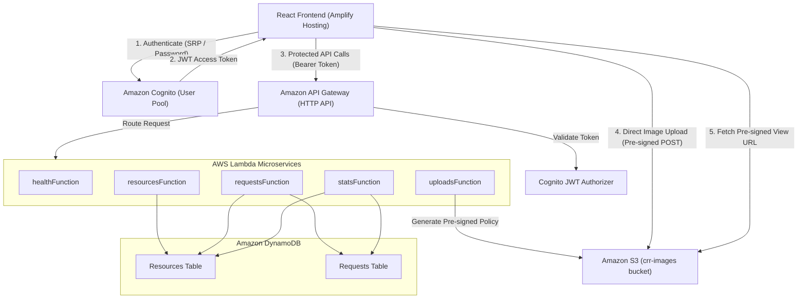

# Campus Resource Rescue

A campus-based resource-sharing platform that enables students to donate, lend, borrow and request unused resources instead of letting them go to waste.

---

## Table of Contents

- [Project Overview](#project-overview)
- [Features](#features)
- [Technology Stack](#technology-stack)
- [Architecture](#architecture)
- [Project Structure](#project-structure)
- [Local Development Setup](#local-development-setup)
- [Environment Variables](#environment-variables)
- [API Documentation](#api-documentation)
- [AWS Deployment](#aws-deployment)
- [Security](#security)
- [Testing](#testing)
- [Future Improvements](#future-improvements)

---

## Project Overview

Campus Resource Rescue tackles material waste and financial strain on university campuses. Every academic semester, textbooks, lab apparatus, electronic gadgets, stationery, and dorm furniture are discarded or left unused, while incoming and continuing students spend significant funds acquiring the exact same equipment.

The platform provides a centralised, authenticated campus exchange where students and faculty can:
- List excess academic supplies and living essentials for donation or temporary loan.
- Discover available items by category, condition, and sharing model.
- Coordinate secure claim requests and approvals through a formal two-party workflow.
- Ensure community accountability through campus-verified accounts.

---

## Features

The platform currently implements the following functionality:

- **User Registration & Authentication**: Sign up with institutional email, full name, department, and account type (Student or Department). Enforces strong password requirements.
- **Email Verification**: Cognito verification code flow confirming ownership of campus email accounts.
- **Resource Listing**: Create detailed listings specifying title, description, category, condition, sharing type (`GIVE_AWAY` or `BORROW`), campus pickup location, and photograph.
- **Resource Browsing & Filtering**: Browse available items with multi-parameter filtering (by category, condition, and sharing type) with cursor-based pagination.
- **Resource Details**: Dedicated view presenting comprehensive item specifications, owner department/identity, listing status, and high-resolution image preview.
- **Direct S3 Image Uploads**: Secure two-step upload flow using pre-signed S3 POST policies, enforcing user-isolated paths, magic byte verification, and 5MB size limits.
- **Give Away Workflow**: Direct transfer of ownership for permanently donated resources.
- **Borrow Workflow**: Temporary lending model allowing students to request and borrow items for coursework or semester duration.
- **Request Submission**: Submit claim requests with a personalized note to the listing owner. Atomic locking prevents multiple concurrent claims on the same resource.
- **Request Decision Management (Accept / Reject)**: Owners can review incoming requests on their dashboard, accept the chosen candidate (automatically transitioning the resource to `PENDING_CLAIM`), or reject others.
- **Personal Dashboard & Analytics**: Tabbed dashboard displaying user-listed resources, outgoing requests, incoming borrower requests, and platform-wide statistics.

---

## Technology Stack

### Frontend
- **Framework**: React 18
- **Build Tool**: Vite 5
- **Language**: JavaScript (ES Modules)
- **Routing**: React Router DOM v7
- **Authentication SDK**: AWS Amplify JavaScript v6 (`@aws-amplify/auth`)

### Backend
- **Runtime**: Node.js 20.x (ES Modules)
- **Compute**: AWS Lambda
- **IaC & Tooling**: AWS Serverless Application Model (SAM) CLI
- **API Management**: Amazon API Gateway (HTTP API v2)

### Cloud Infrastructure
- **Authentication & Identity**: Amazon Cognito User Pools
- **Database**: Amazon DynamoDB (Single-table design patterns with On-Demand capacity)
- **Object Storage**: Amazon S3 (Encrypted, private bucket with CORS and Pre-signed URLs)
- **Monitoring & Logs**: Amazon CloudWatch Logs
- **Frontend Hosting**: AWS Amplify Hosting

---

## Architecture

Campus Resource Rescue utilizes a serverless architecture where the single-page application interacts with backend microservices via API Gateway HTTP API and Amazon Cognito.



### Architectural Highlights

1. **Authentication Flow**:
   Users authenticate directly against Cognito User Pools via AWS Amplify Auth v6. Upon successful login, Cognito returns a short-lived JWT Access Token, ID Token, and Refresh Token.

2. **Protected API Requests & Access Token Usage**:
   All protected endpoints require the HTTP header `Authorization: Bearer <AccessToken>`. The API Gateway JWT Authorizer natively validates token signature, expiration, issuer, and audience before triggering Lambda functions. Unauthenticated or invalid requests are rejected at the edge with HTTP `401 Unauthorized` without incurring compute charges.

3. **Pre-Signed S3 Image Uploads**:
   Images are never uploaded through Lambda functions. The client requests a pre-signed S3 POST policy from `POST /uploads/presign`, which generates a policy restricted to the authenticated user's prefix (`users/{callerSub}/resources/{uuid}.ext`). The browser uploads directly to S3 with multi-part form data. When creating the listing (`POST /resources`), Lambda verifies that the object exists and confirms magic byte integrity (JPEG, PNG, WebP) before persisting the reference.

4. **Resource and Request Lifecycle**:
   - Listings begin as `AVAILABLE`.
   - When a student submits a request, an atomic lock item (`LOCK#{resourceId}#{requesterId}`) is written to DynamoDB in a transaction to prevent duplicate claims.
   - The listing owner accepts a request, transitioning the resource to `PENDING_CLAIM`.
   - Upon completion, the owner marks the item `GIVEN_AWAY` or `BORROWED`.

---

## Project Structure

```text
.
├── amplify.yml                      # AWS Amplify build and deployment specification
├── backend/                         # AWS SAM Serverless backend
│   ├── .gitignore                   # Backend Git ignore rules
│   ├── .npmignore                   # NPM packaging ignore rules
│   ├── package.json                 # Backend dependencies & test scripts
│   ├── package-lock.json            # Backend dependency lockfile
│   ├── samconfig.toml               # SAM CLI deployment parameters (dev & prod)
│   ├── template.yaml                # AWS SAM CloudFormation infrastructure template
│   ├── src/
│   │   ├── handlers/                # AWS Lambda route handlers
│   │   │   ├── health.mjs           # Health check endpoint
│   │   │   ├── requests.mjs         # Request creation, listing & decision logic
│   │   │   ├── resources.mjs        # Resource CRUD & filter operations
│   │   │   ├── stats.mjs            # Aggregated platform statistics
│   │   │   └── uploads.mjs          # S3 Pre-signed upload policy generation
│   │   └── lib/                     # Shared backend utilities
│   │       ├── auth.mjs             # JWT claim extraction & ownership assertions
│   │       ├── dynamodb.mjs         # DynamoDB client wrapper & query helpers
│   │       ├── errors.mjs           # Application error codes & exception classes
│   │       ├── response.mjs         # Standardised JSON response envelopes
│   │       ├── s3.mjs               # S3 client wrapper & pre-signed URL helpers
│   │       └── validate.mjs         # Schema validations, enum checks & cursor codecs
│   └── test/                        # Backend unit & integration test suites
│       ├── handlers/                # Handler unit tests (health, requests, resources, stats, uploads)
│       └── lib/                     # Utility tests (auth, errors, response, validate)
├── docs/                            # Architecture and design documentation
│   ├── api-specification.md         # Full REST API request/response specifications
│   ├── architecture-diagram.md      # Mermaid system diagrams & access patterns
│   ├── backend-architecture.md      # CloudFormation resource designs & IAM policies
│   ├── database-design.md           # DynamoDB single-table schema & query keys
│   └── security-design.md           # Threat model, token validation & S3 security
├── frontend/                        # React + Vite single-page application
│   ├── .env.example                 # Frontend environment template
│   ├── .gitignore                   # Frontend Git ignore rules
│   ├── deploy-amplify.py            # Automated Amplify deployment packaging script
│   ├── e2e-test.mjs                 # Comprehensive end-to-end integration test suite
│   ├── index.html                   # HTML entry point
│   ├── package.json                 # Frontend dependencies & scripts
│   ├── package-lock.json            # Frontend dependency lockfile
│   ├── package-amplify.py           # POSIX ZIP packaging script for Amplify
│   ├── vite.config.js               # Vite bundler configuration
│   ├── public/                      # Static assets & favicon
│   └── src/
│       ├── App.jsx                  # Main application router and shell
│       ├── main.jsx                 # React root renderer
│       ├── components/              # Modular UI components
│       │   ├── common/              # Shared components (Navbar, Footer, Modal, Badge, Spinner)
│       │   ├── home/                # Landing page sections (Hero, HowItWorks, CategoryGrid)
│       │   └── resources/           # Resource cards and filter controls
│       ├── context/                 # React Context providers (AuthContext)
│       ├── data/                    # Mock constants and category metadata
│       ├── pages/                   # Application views (Browse, Detail, Post, Dashboard, Login, Register)
│       ├── services/                # API communication and Amplify Auth wrappers
│       └── styles/                  # CSS modules and design system tokens
├── .env.example                     # Root environment configuration reference
├── .gitignore                       # Repository root Git ignore rules
└── README.md                        # Project documentation
```

---

## Local Development Setup

### Prerequisites
- **Node.js**: v20.x LTS or higher
- **npm**: v10.x or higher
- **AWS CLI**: v2.x installed and configured (`aws configure`)
- **AWS SAM CLI**: v1.115.0 or higher
- **Git**

---

### Step 1: Clone the Repository

```bash
git clone https://github.com/YOUR_ORGANIZATION/campus-resource-rescue.git
cd campus-resource-rescue
```

---

### Step 2: Configure and Run the Frontend

1. Navigate to the frontend directory:
   ```bash
   cd frontend
   ```

2. Install dependencies:
   ```bash
   npm install
   ```

3. Create your local environment file from the example template:
   ```bash
   cp .env.example .env.local
   ```

4. Populate `.env.local` with your backend endpoints (see [Environment Variables](#environment-variables)):
   ```env
   VITE_API_BASE_URL=https://REPLACE_WITH_API_ID.execute-api.ap-southeast-2.amazonaws.com/v1
   VITE_COGNITO_REGION=ap-southeast-2
   VITE_COGNITO_USER_POOL_ID=ap-southeast-2_REPLACE_WITH_POOL_ID
   VITE_COGNITO_CLIENT_ID=REPLACE_WITH_CLIENT_ID
   ```

5. Start the Vite local development server:
   ```bash
   npm run dev
   ```
   The application will be accessible at `http://localhost:5173`.

---

### Step 3: Configure and Build the Backend

1. Navigate to the backend directory:
   ```bash
   cd ../backend
   ```

2. Install dependencies:
   ```bash
   npm install
   ```

3. Validate the SAM CloudFormation template:
   ```bash
   sam validate --region ap-southeast-2
   ```

4. Build the serverless application:
   ```bash
   sam build
   ```

---

## Environment Variables

All frontend runtime configuration is managed through Vite environment variables. Variables prefixed with `VITE_` are bundled into client-side assets and must **never** contain secret keys.

| Variable Name | Purpose | Example / Format |
| :--- | :--- | :--- |
| `VITE_API_BASE_URL` | Base invoke URL for API Gateway HTTP API v2 | `https://example123.execute-api.ap-southeast-2.amazonaws.com/v1` |
| `VITE_COGNITO_REGION` | AWS Region where Cognito User Pool is hosted | `ap-southeast-2` |
| `VITE_COGNITO_USER_POOL_ID` | Identifier of the Cognito User Pool | `ap-southeast-2_ab12CD34` |
| `VITE_COGNITO_CLIENT_ID` | Public Cognito SPA App Client ID (no secret) | `1a2b3c4d5e6f7g8h9i0j1k2l3m` |

> [!IMPORTANT]
> The Cognito User Pool ID and Client ID are public identifiers required for SRP authentication; they do not grant unauthorized access without user credentials. Never store AWS secret access keys or private credentials in `.env` files.

---

## API Documentation

All endpoints are hosted under the base prefix `/v1`.

| HTTP Method | Endpoint | Authentication | Purpose |
| :--- | :--- | :---: | :--- |
| `GET` | `/health` | Public | Service health and operational status probe |
| `GET` | `/resources` | Public | Browse catalog with category, sharing type, condition filters, and pagination |
| `GET` | `/resources/{id}` | Public | Retrieve single resource details and pre-signed image view URL |
| `POST` | `/resources` | Protected (Cognito JWT) | Publish a new resource listing |
| `PATCH` | `/resources/{id}` | Protected (Owner only) | Update listing status (e.g. `AVAILABLE` or `GIVEN_AWAY`) |
| `POST` | `/resources/{id}/requests` | Protected (Cognito JWT) | Submit a claim/borrow request for an available resource |
| `GET` | `/requests/my` | Protected (Cognito JWT) | Retrieve incoming and outgoing requests for the authenticated user |
| `POST` | `/requests/{id}/decision` | Protected (Owner only) | Accept or reject a pending request (`ACCEPT` or `REJECT`) |
| `POST` | `/uploads/presign` | Protected (Cognito JWT) | Generate pre-signed S3 POST upload policy scoped to user directory |
| `GET` | `/stats` | Public | Summary statistics for platform homepage and dashboard |

---

## AWS Deployment

### Backend Deployment (AWS SAM)

The backend is packaged and deployed using the AWS Serverless Application Model (SAM):

```bash
cd backend
sam build
sam deploy --guided
```

Configuration is persisted in [`backend/samconfig.toml`](file:///e:/Cloud%20Project/backend/samconfig.toml). The development stack automatically provisions:
- API Gateway HTTP API with native JWT authorizer and CORS rules.
- 5 Node.js Lambda functions with least-privilege IAM execution roles.
- 2 DynamoDB tables (`crr-resources-dev`, `crr-requests-dev`) with Global Secondary Indexes.
- 1 S3 Bucket (`crr-images-{AccountId}-dev`) with AES-256 server-side encryption and private block-public-access settings.
- 1 Cognito User Pool with email verification and an unauthenticated public SPA client.

### Frontend Deployment (AWS Amplify Hosting)

The frontend is hosted on AWS Amplify Hosting using manual ZIP-based deployments:

1. Build static production bundle:
   ```bash
   cd frontend
   npm run build
   ```
2. Package the `dist` directory ensuring POSIX-compliant paths:
   ```bash
   python package-amplify.py
   ```
3. Deploy the resulting `dist.zip` archive to Amplify:
   ```bash
   python deploy-amplify.py
   ```

---

## Security

Campus Resource Rescue incorporates security best practices across all architectural tiers:

- **Cognito JWT Validation**: Protected routes are safeguarded by native API Gateway JWT authorizers validating token signature, expiration (`exp`), issuer (`iss`), and audience (`aud`).
- **Owner-Based Authorization**: Lambda handlers verify that `caller.sub` matches the `ownerId` of the target entity before granting update or decision permissions.
- **Atomic Concurrency Controls**: DynamoDB conditional writes (`attribute_not_exists`) prevent race conditions, duplicate claims, and double-booking.
- **Private S3 Storage & Zero Public Read**: S3 bucket blocks all public access (`BlockPublicAcls`, `BlockPublicPolicy`, `IgnorePublicAcls`, `RestrictPublicBuckets`). Objects are accessed solely through time-limited pre-signed URLs (1 hour TTL).
- **User-Isolated Upload Paths**: Pre-signed POST upload policies strictly enforce the object prefix `users/${callerSub}/resources/`. Users cannot write to another user's path.
- **Magic Byte Validation**: Lambda validates image buffer magic bytes to ensure uploaded files are genuine JPEG, PNG, or WebP images before publishing.
- **Strict CORS Policy**: API Gateway and S3 CORS policies explicitly restrict origins to the deployed Amplify frontend and local development server with zero wildcard (`*`) origins.

---

## Testing

### Backend Unit Tests
The backend features 52 unit and integration tests across 16 test suites covering route handlers, authorization checks, validation rules, cursor pagination, and response envelopes.

Run backend tests using Node's native test runner:
```bash
cd backend
npm test
```

### End-to-End Integration Testing
The project includes a comprehensive end-to-end test script that verifies the full user journey against live AWS infrastructure (Cognito authentication, API Gateway preflight, S3 upload, and DynamoDB transactions):

```bash
cd frontend
node e2e-test.mjs
```

---

## Future Improvements

- **Real-Time In-App Messaging**: Direct messaging between listing owners and requesters via AWS AppSync (GraphQL subscriptions) or API Gateway WebSocket API.
- **Automated CI/CD**: Continuous integration and deployment pipelines using GitHub Actions for automated SAM testing and Amplify deployments.
- **Automated Email Notifications**: Transactional email updates via Amazon SES alerting users when requests are submitted, accepted, or rejected.
- **User Reputation & Badges**: Community karma ratings and verified badges for frequent contributors to incentivize sustainable resource sharing.
- **Multi-Campus Support**: Multi-tenant institutional domain verification allowing independent university chapters on a shared platform.
