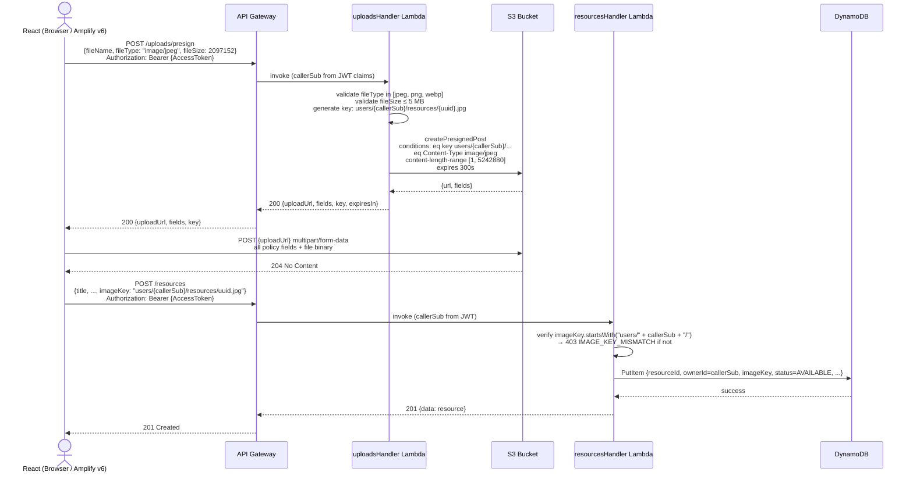
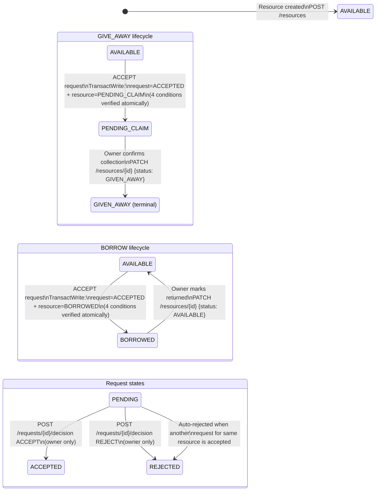
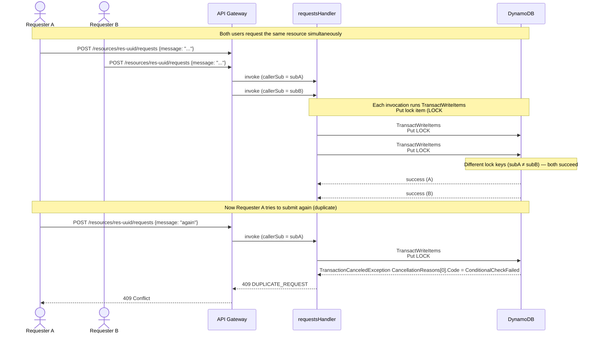
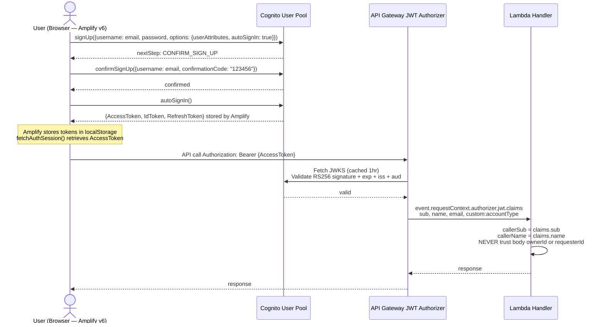

# Architecture Diagram — Campus Resource Rescue

**Region:** `ap-southeast-2` (Asia Pacific — Sydney)  
**Account:** `072718159688`

---

## Full System Architecture

```mermaid
flowchart TD
    subgraph Users["👥 Users"]
        S["🎓 Student (Browser)"]
        D["🏛️ Department / Lab (Browser)"]
    end

    subgraph Amplify["☁️ AWS Amplify Hosting  ap-southeast-2"]
        React["⚛️ React SPA  Vite Build\naws-amplify v6\nCI/CD via amplify.yml"]
    end

    subgraph Auth["🔐 Amazon Cognito  ap-southeast-2"]
        UP["User Pool\ncampus-resource-rescue-users\nEmail + Password  Email Verification\ncustom:accountType  custom:department"]
        AC["App Client  No secret — SPA\nUSER_PASSWORD_AUTH  USER_SRP_AUTH\nREFRESH_TOKEN_AUTH"]
    end

    subgraph APIGW["🌐 AWS Serverless::HttpApi  Stage: v1"]
        GW["HTTP API\ncampus-resource-rescue-api\nBase URL: execute-api.ap-southeast-2.amazonaws.com/v1"]
        JWTAUTH["JWT Authorizer\nvalidates Cognito AccessToken\nIssuer: cognito-idp / UserPool\nAudience: AppClientId"]
    end

    subgraph Lambda["⚡ AWS Lambda  Node.js 24.x  arm64"]
        L1["resourcesHandler\nGET /resources\nGET /resources/{id}\nPOST /resources\nPATCH /resources/{id}"]
        L2["requestsHandler\nPOST /resources/{id}/requests\nPOST /requests/{id}/decision\nGET /requests/my"]
        L3["uploadsHandler\nPOST /uploads/presign"]
        L4["statsHandler\nGET /stats"]
        L5["healthHandler\nGET /health"]
    end

    subgraph DDB["🗄️ Amazon DynamoDB  PAY_PER_REQUEST"]
        RT["Resources Table\nPK: resourceId\nGSI-1: ownerIndex ownerId+createdAt\nGSI-2: statusCreatedIndex status+createdAt\nGSI-3: categoryStatusIndex category+createdAt\nStatuses: AVAILABLE  PENDING_CLAIM\nBORROWED  GIVEN_AWAY"]
        RQ["Requests Table\nPK: requestId\nGSI-1: ownerRequestsIndex ownerId+createdAt\nGSI-2: requesterRequestsIndex requesterId+createdAt\nGSI-3: resourceRequestsIndex resourceId+status\nLock items: LOCK#resourceId#requesterId\nStatuses: PENDING  ACCEPTED  REJECTED"]
    end

    subgraph S3Bucket["🪣 Amazon S3  ap-southeast-2"]
        BKT["Private Bucket\ncampus-resource-rescue-images\nBlock all public access\nSSE-S3  BucketOwnerEnforced\nKey prefix: users/{sub}/resources/{uuid}.ext"]
    end

    subgraph IAM["🔑 IAM — Separate Roles"]
        R1["ResourcesFunctionRole\nDynamoDB: GetItem PutItem UpdateItem Query\nS3: GetObject"]
        R2["RequestsFunctionRole\nDynamoDB: GetItem PutItem UpdateItem DeleteItem\nQuery BatchWriteItem TransactWriteItems\nBoth tables"]
        R3["UploadsFunctionRole\nS3: PutObject on users/ prefix only"]
        R4["StatsFunctionRole\nDynamoDB: Query Scan  Read-only"]
        R5["HealthFunctionRole\nNo DynamoDB or S3"]
    end

    subgraph Monitor["📊 Amazon CloudWatch  ap-southeast-2"]
        LOGS["Log Groups  RetentionDays=7\n/aws/lambda/crr-resources\n/aws/lambda/crr-requests\n/aws/lambda/crr-uploads\n/aws/lambda/crr-stats\n/aws/lambda/crr-health"]
        ALARM["Alarm: campus-api-5xx-errors\nThreshold: 5 errors / 5 minutes"]
    end

    S -->|HTTPS| React
    D -->|HTTPS| React

    React -->|"1 signUp + confirmSignUp (Amplify v6)"| UP
    React -->|"2 signIn → AccessToken IdToken RefreshToken (Amplify v6)"| AC

    React -->|"3 API calls  Authorization: Bearer AccessToken"| GW
    GW --> JWTAUTH
    JWTAUTH -.->|"JWKS validation cached 1hr"| UP

    GW -->|"/resources*  Auth: NONE or CognitoAuthorizer"| L1
    GW -->|"/requests*  CognitoAuthorizer"| L2
    GW -->|"/uploads/presign  CognitoAuthorizer"| L3
    GW -->|"/stats  Auth: NONE"| L4
    GW -->|"/health  Auth: NONE"| L5

    L1 --- R1
    L2 --- R2
    L3 --- R3
    L4 --- R4
    L5 --- R5

    L1 <-->|"GetItem PutItem UpdateItem\nConditionExpression: ownerId=callerSub"| RT
    L2 <-->|"TransactWriteItems (4 conditions)\nBatchWriteItem auto-reject others"| RQ
    L2 <-->|"TransactWriteItems resource status\nPENDING_CLAIM or BORROWED"| RT
    L4 -->|"Parallel Query per category\ncategoryStatusIndex  60s cache"| RT
    L4 -->|"Scan SELECT COUNT"| RQ

    L3 -->|"createPresignedPost\neq key users/{sub}/resources/{uuid}\ncontent-length-range 1→5MB\nexact Content-Type match\nexpires 300s"| BKT

    React -->|"4 Direct S3 Upload  POST multipart with policy fields"| BKT
    BKT -->|"204 No Content"| React

    L1 -->|"GetObject presigned GET URL  1hr expiry  generated at read time  never stored"| BKT

    L1 -.->|structured JSON logs| LOGS
    L2 -.->|structured JSON logs| LOGS
    L3 -.->|structured JSON logs| LOGS
    L4 -.->|structured JSON logs| LOGS
    LOGS -.-> ALARM
```

---

## Pre-Signed Upload Flow (with ownership enforcement)

---

## Request Lifecycle — State Machine

---

## Duplicate Request Prevention — Transaction Flow

---

## JWT Authentication Flow

